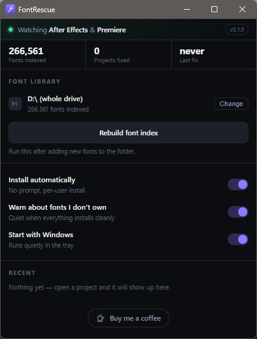

# FontRescue

**Every project opens with the fonts it expects.** FontRescue watches After Effects and
Premiere Pro, reads the fonts a project asks for, and installs the ones you already own —
straight from your own font archive. No dialogs, no hunting through folders, no admin rights.



## The problem

You open a project. Adobe says *"Fonts are missing"* and substitutes something that ruins the
layout. So you search your drive for the font, install it, close the project, reopen it, and
hope nothing else is missing. Every single time.

## What it does

1. **Notices the project.** It reads the project path from the After Effects or Premiere
   window and from Adobe's own recent-project list. No wrappers, no file-association tricks,
   no scripts inside Adobe.
2. **Reads the fonts it needs.** After Effects projects store the font names directly. Premiere
   stores them in the graphics it references — FontRescue follows those and reads them too.
3. **Finds them in your library.** Your fonts stay where they are; FontRescue indexes the
   folder once (a few seconds for hundreds of thousands of files), caches the list, and looks
   up matches by real font name, not file name.
4. **Installs the missing ones** into your own Windows profile and tells you.
5. **Says what it couldn't find.** Anything genuinely absent from your library is listed by
   its exact font name — click it to copy, so you can go and buy or download it.

After Effects reads fonts at launch, so it asks you to reopen the project. Premiere picks them
up on its own.

## Why it is built this way

- **Per-user install, no administrator rights.** Fonts go to
  `%LOCALAPPDATA%\Microsoft\Windows\Fonts` and are registered for your user. Nothing
  system-wide is touched and nothing needs a reboot. Because of that they will not appear in
  `C:\Windows\Fonts` — that folder is machine-wide.
- **Nothing leaves your machine.** No account, no server, no upload. Your font names, project
  paths and history never leave the PC.
- **Your library is never copied or reorganised.** FontRescue only reads names to build its
  index; it copies a file only when it installs that one font.

## Install

1. Download the latest installer from the Releases page of this repository.
2. Run it. Windows may show **"Windows protected your PC"** — that is SmartScreen reacting to an
   unsigned app, not a virus warning. Choose **More info → Run anyway**.
3. It installs for your user only, adds a Start Menu shortcut and a desktop shortcut, and starts
   in the notification area.

On first run, pick the folder where your fonts live. That is the only thing you have to set up.
If you add fonts later, press **Rebuild font index**.

**Requirements:** Windows 10 or 11, 64-bit. After Effects and Premiere are optional — the app
just sits in the tray until a project opens.

## Uninstall

Windows **Settings → Apps → FontRescue → Uninstall**, or run `uninstall.exe` from
`%LOCALAPPDATA%\FontRescue`. Fonts it installed stay installed — remove those the usual way if
you want them gone.

## Authenticity — check this before you run it

**Only download FontRescue from this repository's Releases page.** If you got it anywhere else,
do not run it.

Verify the file you downloaded, in PowerShell:

```powershell
Get-FileHash .\FontRescue_0.1.0_x64-setup.exe -Algorithm SHA256
```

The result must be exactly:

```
c0fdfa9167ab32a55cd93edc48fcc8241fe307b9926131e0173326004465b854
```

After installing, the program file `%LOCALAPPDATA%\FontRescue\FontRescue.exe` must have this
SHA-256:

```
893deb39b0cb59b7fce50e9fa656cc7bae8fcbf6471ca4b32f2c4324ba0b6c0b
```

**If either fingerprint does not match, stop and delete the file — do not run it.** A mismatch
means the file was modified or came from somewhere else.

## Privacy

**FontRescue doesn't collect personal data and has no analytics.** There is no telemetry, no
crash reporting, no account and no update pings. It works offline and makes no network requests
of its own; its only outbound action is opening the "Buy me a coffee" link when you click it.
What it reads — project files and font names — stays on your computer, in
`%APPDATA%\FontRescueRust`.

## Build from source

Needs Rust, the Tauri CLI and Node.js.

```bash
npm i -g @tauri-apps/cli@^2
cargo build --release        # -> target/release/FontRescue.exe
tauri build                  # -> installer in target/release/bundle/nsis/
```

To keep your own folder names out of the compiled binary:

```bash
RUSTFLAGS="--remap-path-prefix=$USERPROFILE=cargo" tauri build
```

## Licence

MIT — see LICENSE. Use it, fork it, ship it.

## Support

If FontRescue saved you a few minutes, you can [buy me a coffee](https://paypal.me/maitfx).
It stays free either way.
